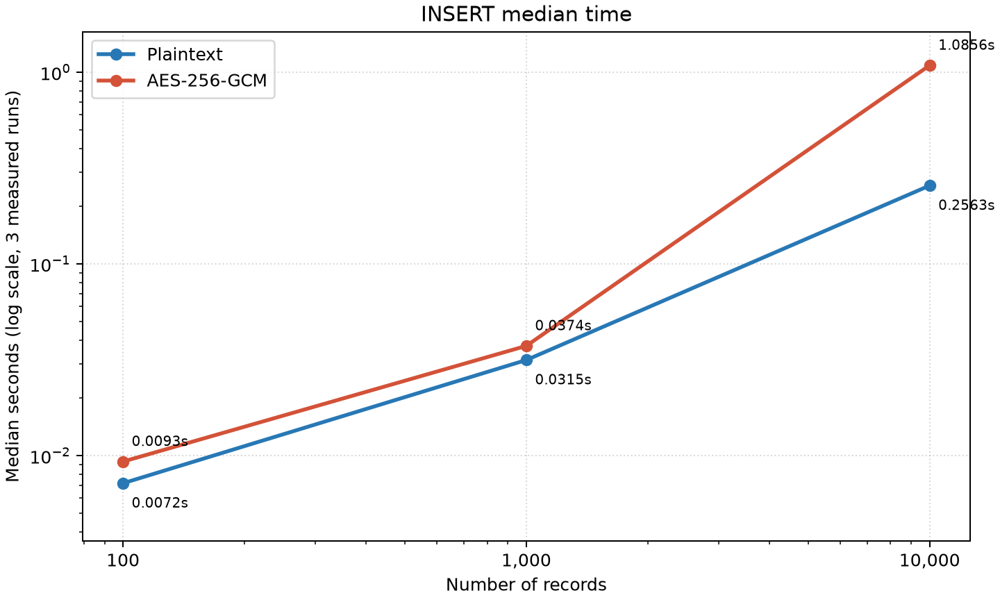
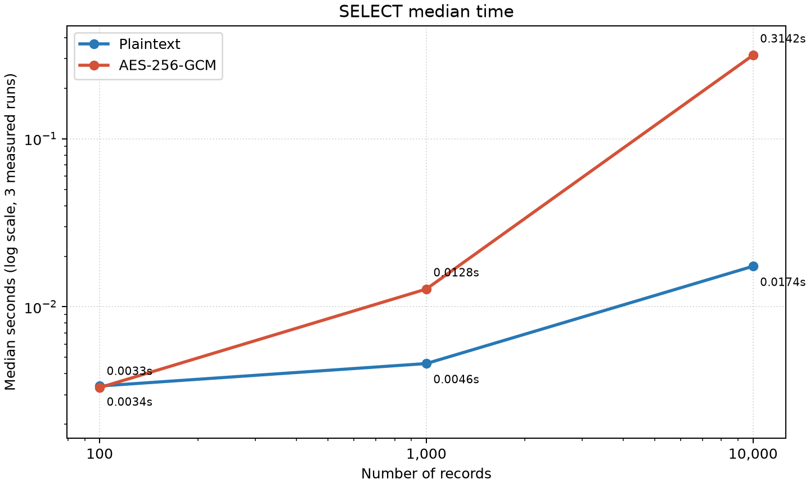

# BÁO CÁO ĐỒ ÁN: MÃ HÓA DỮ LIỆU NHẠY CẢM TRONG CƠ SỞ DỮ LIỆU

Môn: Mật mã và An toàn thông tin

Nhóm 3 thành viên: TV1 [họ tên, MSSV]; TV2 [họ tên, MSSV]; TV3 [họ tên, MSSV]

Bản ghép để nhóm rà soát, 16/11/2026. Chưa phải bản nghiệm thu trên main.

Ngày cập nhật: 16/11/2026. Đề tài: mã hóa dữ liệu nhạy cảm tại tầng ứng dụng trước khi lưu PostgreSQL. Bản này dùng dữ liệu giả và mô tả đúng mã nguồn đã tích hợp; TV1 cần xác nhận nội dung học thuật khi nộp.

## Chương 1. Mở đầu

### 1.1. Bối cảnh và vấn đề

Ứng dụng thường lưu thông tin cá nhân trong cơ sở dữ liệu. Nếu người tấn công chỉ lấy được bản sao DB hoặc quyền đọc SQL, cột ở dạng rõ cho phép họ đọc dữ liệu ngay. Đề tài xây dựng một hệ thống hồ sơ sinh viên giả lập để kiểm tra cách mã hóa ba trường nhạy cảm (`national_id`, `phone`, `address`) **trước** khi ghi vào PostgreSQL. `student_id`, họ tên và ngành học được giữ rõ theo thiết kế, giúp quan sát ranh giới bảo vệ thay vì gọi toàn bộ DB là đã được mã hóa.

### 1.2. Mục tiêu và câu hỏi nghiên cứu

1. Triển khai API CRUD với hai vai trò admin/viewer, lưu ba trường nhạy cảm dưới dạng ciphertext và nonce; người có quyền đọc vẫn nhận được plaintext qua API.
2. Kiểm tra tính bí mật khi chỉ đọc DB mà không có khóa, phát hiện sửa/tráo dữ liệu qua AES-256-GCM và AAD, đồng thời ghi rõ các trường hợp hệ thống không bảo vệ được.
3. Tự động kiểm thử hợp đồng H1–H5, mô phỏng A1–A8, đo overhead ghi/đọc và kích thước payload trên PostgreSQL thật.

Câu hỏi thực nghiệm là: “Mã hóa ở tầng ứng dụng thay đổi điều gì đối với dữ liệu nhìn thấy trong DB, khả năng phát hiện sửa dữ liệu, và chi phí xử lý?” Kết quả được giới hạn ở dữ liệu giả và môi trường demo cục bộ.

### 1.3. Phạm vi và phương pháp

FastAPI kiểm tra token, validate JSON và gọi `CryptoService` trước khi ghi bằng SQLAlchemy. PostgreSQL 17 lưu ciphertext và nonce dưới kiểu `BYTEA`; khóa được nạp từ `.env` ngoài bảng. Bộ test dùng pytest/SQLite cô lập; smoke, attack lab và benchmark dùng PostgreSQL thật trong Docker. Nhóm áp dụng TDD cho phần mật mã, review chéo theo chủ file và CI trên PR.

Thử nghiệm không triển khai TLS công khai, KMS, xoay khóa, migration, tìm kiếm trên ciphertext hay chống replay cùng ô. Demo dùng token tĩnh và HTTP loopback; không dùng dữ liệu cá nhân thật. Chi tiết kiến trúc và API ở [Chương 3–4](TV2_BAO_CAO_CHUONG_3_4.md); phép đo và giới hạn ở [Chương 5](TV3_BAO_CAO_CHUONG_5.md).

### 1.4. Đóng góp và cấu trúc báo cáo

TV1 phụ trách key/crypto/auth và thiết kế mật mã; TV2 phụ trách API/DB/Docker; TV3 phụ trách CI, security tests, attack lab và benchmark. Chương 2 giải thích AES-GCM và threat model; Chương 3–4 trình bày thiết kế/triển khai; Chương 5 là thực nghiệm; Chương 6 tổng hợp kết quả và hướng phát triển. Các vai trò này là phân công của kế hoạch, không thay cho xác nhận review trên GitHub.

## Chương 2. Cơ sở lý thuyết và mô hình đe dọa

### 2.1. Mã hóa có xác thực AES-256-GCM

AES-GCM là chế độ mã hóa có xác thực (AEAD). Với khóa 32 byte `K`, nonce 12 byte `N`, plaintext UTF-8 `P` và associated data `A`, hàm mã hóa tạo ciphertext kèm tag xác thực 16 byte; có thể viết ngắn là `(C, T) = AES-GCM-Encrypt(K, N, P, A)`. `N` không cần bí mật nhưng không được tái sử dụng với cùng khóa. Giải mã chỉ trả plaintext khi tag hợp lệ; sửa ciphertext, nonce hoặc AAD sẽ gây lỗi xác thực. Trong code, lỗi sai tag và plaintext giải mã không phải UTF-8 đều được chuẩn hóa thành `IntegrityFailure`, để API trả 409 `integrity_failure` thay vì lộ chi tiết nội bộ.

Mỗi lần `encrypt` sinh nonce bằng `os.urandom(12)`. Đây là nonce ngẫu nhiên; dự án không có bộ đếm hoặc sổ đăng ký bảo đảm duy nhất tuyệt đối. `EncryptedValue` giữ `ciphertext`, `nonce`, `key_version`; `CryptoService` từ chối khóa không đúng 32 byte và giải mã với key version không khớp.

### 2.2. Associated data ràng buộc ngữ cảnh

AAD có định dạng chính xác `student:{student_id}|field:{field}|key:{key_version}`. Nó không được mã hóa nhưng được tag bảo vệ. Khi chép cặp ciphertext/nonce của `SV9002` sang `SV9001` hoặc từ `phone` sang `national_id`, AAD khi giải mã khác AAD lúc mã hóa, nên giải mã thất bại. Ngược lại, AAD không chứa bộ đếm thay đổi bản ghi: chép lại ciphertext **cũ của chính cùng hàng/cùng field** vẫn có thể giải mã (A7). Đây là giới hạn đã được test C07 xác nhận.

### 2.3. Khóa và quyền truy cập

`scripts/init_env.py` sinh khóa AES 32 byte rồi mã hóa Base64 trong `.env`, cùng token admin/viewer và mật khẩu DB. `decode_key` từ chối Base64 sai hoặc khóa không đủ 32 byte. `.env` bị Git bỏ qua và Dockerfile không chép khóa vào image; mất khóa sẽ làm dữ liệu cũ không giải mã được. Admin được CRUD, viewer chỉ đọc; không có hoặc sai Bearer token trả 401, viewer ghi/xóa trả 403. Hai token tĩnh chỉ phù hợp demo cục bộ.

### 2.4. Threat model và ranh giới bảo vệ

Kẻ tấn công được xét gồm: người gọi API chưa xác thực; viewer vượt quyền; người có dump DB nhưng không có khóa; người có quyền sửa byte DB; và người gửi ID dạng SQL injection. Kịch bản A1–A8 và expected/actual nằm ở [Chương 5](TV3_BAO_CAO_CHUONG_5.md) và [threat model](threat_model.md). Bản dump vẫn lộ `student_id`, họ tên, ngành, số hàng và độ dài ciphertext. Nếu khóa hoặc máy ứng dụng bị chiếm, bảo vệ ở lớp này không còn; AES-GCM phát hiện việc sửa dữ liệu nhưng không tự phục hồi byte bị phá hỏng.

### 2.5. Cách kiểm chứng phần mật mã

Bốn file test TV1 kiểm H1/C01–C07, khóa, auth và init_env. Lịch sử commit test trước code của PR AES-GCM và PR sửa UTF-8 thể hiện hai vòng TDD cụ thể. Lần tái kiểm ngày 16/11 cho **48 passed**, coverage 100% dòng/nhánh trên 93 câu lệnh và 18 nhánh; 18/19 mutant do script tái kiểm độc lập bị test bắt. M13 thay `compare_digest` bằng `==` sống sót qua functional tests, vì vậy cần đọc code/review cho tính chất so sánh token. [Lệnh và bằng chứng](evidence/tv1_coverage_2026-11-16.md) ghi rõ phạm vi của con số này; không suy ra mọi tính chất bảo mật đều đã được chứng minh.

### 2.6. Tài liệu tham khảo kỹ thuật

Thiết kế và nguồn kỹ thuật chi tiết được ghi tại [crypto_design.md](crypto_design.md); API/schema ở [api_db.md](api_db.md); phép thử và số liệu ở [Chương 5](TV3_BAO_CAO_CHUONG_5.md). Khi xuất báo cáo nộp, nhóm cần chuẩn hóa trích dẫn thư viện `cryptography`, tài liệu PostgreSQL và kế hoạch nội bộ theo mẫu môn học.

Ngày cập nhật: 16/11/2026. Người thực hiện: [điền họ tên, MSSV].

Tài liệu mô tả bản tích hợp local `integration/tv2-merge-prep`: API/DB của TV2, AES-256-GCM của TV1 đã merge vào main và phần kiểm thử của TV3. Phần 4.5 được đối chiếu với mã TV1 và tài liệu `docs/crypto_design.md`; phần 4.6 ghi kết quả chạy thực tế. Nhóm cần review và ghép báo cáo cuối; chưa coi các kiểm tra local là PR đã được duyệt hoặc bản phát hành.

## Chương 3. Phân tích và thiết kế hệ thống

### 3.1. Bài toán và yêu cầu

Hệ thống quản lý một tập hồ sơ sinh viên giả lập gồm mã sinh viên, họ tên, ngành học, số định danh, số điện thoại và địa chỉ. Mục tiêu là nghiên cứu việc bảo vệ các trường nhạy cảm trước khi chúng được lưu vào PostgreSQL. Ba trường national_id, phone và address đi qua module mật mã ở tầng ứng dụng; student_id, full_name và major được giữ rõ để minh họa ranh giới bảo vệ.

Chức năng chính gồm tạo hồ sơ, đọc một hồ sơ, liệt kê hồ sơ, cập nhật toàn bộ thông tin có thể sửa và xóa hồ sơ. Người có vai trò admin được đọc và ghi; viewer chỉ được đọc. Mã sinh viên chỉ gồm chữ và số ASCII, dài từ 1 đến 16 ký tự. Dữ liệu đầu vào phải đủ trường, không chứa trường thừa và không vượt kích thước đã quy định.

Yêu cầu phi chức năng bao gồm triển khai lại được bằng Docker Compose, tách cấu hình khỏi mã nguồn, không ghi khóa/token vào log, báo lỗi ổn định để kiểm thử tự động và giữ nguyên các giao diện mà các thành viên đã thống nhất. Tất cả dữ liệu sử dụng trong thực nghiệm là dữ liệu giả.

### 3.2. Lựa chọn mã hóa ở tầng ứng dụng

Ứng dụng gọi CryptoService trước khi ghi các giá trị nhạy cảm xuống DB. Lựa chọn này phù hợp với câu hỏi nghiên cứu: khi một đối tượng chỉ đọc được bảng hoặc bản sao DB nhưng không có khóa, dữ liệu của các trường được bảo vệ phải khó đọc được nếu module AES-GCM được triển khai đúng. Khóa được nạp riêng qua cấu hình, không nằm trong bảng students.

Cách bố trí này đưa việc giải mã vào đường xử lý của API. API cần kiểm tra quyền trước khi trả dữ liệu rõ cho người dùng. Nó cũng tạo ra chi phí mã hóa/giải mã và làm mất khả năng truy vấn trực tiếp theo nội dung rõ của các cột được mã hóa. Trong phạm vi hiện tại, nhóm chưa thiết kế chỉ mục tìm kiếm trên ciphertext.

Ranh giới bảo vệ không bao gồm máy ứng dụng đã bị chiếm, khóa bị lộ hay người dùng hợp lệ đọc dữ liệu qua API. Tên, ngành, ID, số lượng hồ sơ và kích thước dữ liệu vẫn có thể quan sát được. Không thể kết luận toàn bộ DB được che giấu chỉ vì ba trường đã mã hóa.

### 3.3. Kiến trúc và phân chia trách nhiệm

Luồng hệ thống gồm bốn thành phần: client/Swagger, API FastAPI, CryptoService và PostgreSQL. Client gửi yêu cầu qua HTTP trên loopback. FastAPI gọi dependency xác thực của TV1, kiểm tra payload bằng Pydantic, rồi sử dụng student_service để chuyển đổi giữa dữ liệu API và đối tượng lưu trữ. SQLAlchemy chịu trách nhiệm tương tác với PostgreSQL.

TV1 cung cấp decode_key, CryptoService, EncryptedValue, IntegrityFailure, require_admin và require_reader theo H1. TV2 phụ trách cấu hình, phiên DB, model, schema API, mapping dữ liệu, route và Docker. TV3 dùng H2/H3 để xây test bảo mật, attack lab và benchmark. Việc tách trách nhiệm cho phép TV2 kiểm thử luồng ứng dụng với bản crypto tạm rồi chuyển sang bản thật mà không sửa route.

Khóa và token được sinh cục bộ, đặt trong .env bị Git bỏ qua. Cổng API mặc định 8000, cổng PostgreSQL công bố ra host là 55432. Trong mạng Compose, API kết nối service db qua cổng 5432. Cả hai cổng host đều chỉ bind 127.0.0.1.

### 3.4. Thiết kế lưu trữ

Bảng students có khóa chính student_id kiểu VARCHAR(16). Hai cột full_name và major lần lượt là VARCHAR(150) và VARCHAR(100). Mỗi trường nhạy cảm có một cặp cột BYTEA: national_id_ct/national_id_nonce, phone_ct/phone_nonce, address_ct/address_nonce. Cột key_version là VARCHAR(20). Mọi cột đều không cho NULL.

Theo hợp đồng H1 của thiết kế mục tiêu, ciphertext chứa cả tag xác thực 16 byte, nonce dài 12 byte và key_version xác định phiên bản khóa. Tầng TV2 không tự sinh nonce và không trực tiếp gọi AESGCM; toàn bộ thao tác này nằm trong CryptoService. Các tên cột được giữ ổn định để TV3 đọc bằng SQL trong thử nghiệm.

BYTEA biểu diễn dữ liệu nhị phân. Hàm encode(..., 'hex') chỉ chuyển byte sang ký tự hex để quan sát; một chuỗi rõ cũng có thể được biểu diễn bằng hex. Vì vậy, ảnh chụp cột hex chỉ chứng minh kiểu lưu trữ, không đủ chứng minh tính bí mật [1].

### 3.5. API và phân quyền

GET /health công khai để kiểm tra tiến trình còn phản hồi. POST /students yêu cầu admin và trả 201. GET /students và GET /students/{student_id} cho phép admin hoặc viewer và trả dữ liệu sau giải mã. PUT /students/{student_id} yêu cầu admin, nhận đủ 5 trường có thể sửa và trả 200. DELETE yêu cầu admin, trả 204 với body rỗng.

Thiếu hoặc sai token trả 401 kèm WWW-Authenticate: Bearer. Viewer thực hiện ghi trả 403. Không tìm thấy hồ sơ trả 404 với code not_found. Trùng mã trả 409 với code duplicate_student. Lỗi xác thực dữ liệu mã hóa trả 409 với code integrity_failure. Đầu vào sai schema trả 422.

GET danh sách áp dụng quy tắc trả lỗi toàn bộ nếu bất kỳ hồ sơ nào không giải mã được. API trả danh sách student_ids bị lỗi và không trả kèm các hồ sơ giải mã thành công. PUT không cho đổi student_id vì ID là thành phần dùng khi gọi crypto. DELETE không giải mã để admin có thể dọn hồ sơ hỏng hoặc dữ liệu từ bản crypto cũ.

### 3.6. Luồng tạo, đọc và cập nhật

Khi tạo, API kiểm tra quyền admin và schema, kiểm tra trùng mã, tạo đối tượng Student, rồi gọi encrypt ba lần với đúng student_id và tên field. Ciphertext và nonce được gán vào các cột tương ứng, phiên bản khóa được lưu cùng hàng. Sau commit, API chuyển hàng về StudentOut qua decrypt để trả dữ liệu rõ cho client được phép.

Khi đọc, API kiểm tra quyền reader, tìm hàng bằng khóa chính, dựng EncryptedValue từ từng cặp ciphertext/nonce và key_version, rồi gọi decrypt với đúng ID và tên trường. Hàng không tồn tại được xử lý riêng với lỗi dữ liệu không xác thực. Với bản AES-GCM mục tiêu, AAD gắn dữ liệu với ID, field và phiên bản khóa theo H1.

Khi cập nhật, API giữ nguyên ID, mã hóa lại cả ba trường nhạy cảm và cập nhật các trường rõ trong một giao dịch. Mỗi lần gọi crypto phải tạo nonce mới. Dữ liệu mã hóa được chuẩn bị xong trước khi gán lên hàng. Các câu truy vấn dùng ORM/tham số, không nối đầu vào người dùng vào SQL.

### 3.7. Giới hạn thiết kế

Hệ thống chỉ nạp một khóa hoạt động, chưa có keyring hay rotation. AAD không tự cung cấp trạng thái chống replay: dữ liệu cũ của cùng hàng và cùng field có thể vẫn hợp lệ. Token tĩnh không cung cấp quản trị danh tính đầy đủ. Schema hiện dùng create_all thay vì migration. Danh sách chưa phân trang và mọi vai trò reader có thể xem toàn bộ hồ sơ; đây là phạm vi demo đã chọn.

## Chương 4. Triển khai hệ thống

### 4.1. Môi trường và cấu trúc chương trình

Môi trường kiểm thử phần TV2 sử dụng Python 3.12, FastAPI 0.118.0, SQLAlchemy 2.0.49, psycopg 3.2.6, Pydantic Settings 2.10.1 và pytest 8.4.2. Dockerfile dùng python:3.12-slim; Compose dùng postgres:17. Phiên bản PostgreSQL thực tế được ghi trong docs/tv2_verification.json để tránh suy diễn từ tag image.

Các file chính gồm config.py, database.py, models.py, schemas.py, dependencies.py, student_service.py, main.py và init_db.py. scripts/demo_client.py chuẩn bị dữ liệu H5; tests/test_api.py kiểm tra hợp đồng API. requirements.txt và tests/conftest.py dùng nguyên bản TV3 tại commit 3edd89b; TV3 tiếp tục quản lý dependencies và fixture chung.

### 4.2. Cấu hình và kết nối DB

Settings đọc .env UTF-8 và biến môi trường, ưu tiên biến môi trường của tiến trình. get_settings có cache để tránh đọc lại cấu hình theo mỗi request. get_crypto lấy khóa qua decode_key và tạo CryptoService dùng chung. DB engine bật pool_pre_ping; SessionLocal không autoflush và không expire sau commit.

get_db cấp Session theo request và đóng khi xử lý xong. Khi POST gặp lỗi toàn vẹn DB, chương trình rollback trước khi truy vấn lại để phân biệt trùng mã do tranh chấp với lỗi ràng buộc khác. SQLAlchemy yêu cầu rollback sau lỗi flush để tiếp tục sử dụng Session [2]. Lỗi mật mã IntegrityFailure được xử lý riêng, không nhầm với IntegrityError của DB.

### 4.3. Triển khai module API

Pydantic định nghĩa StudentUpdate làm nền cho StudentPayload và StudentOut. StudentUpdate không có student_id, đồng thời cấm trường thừa nên PUT kèm ID bị từ chối. Route dùng dependency require_admin hoặc require_reader của TV1; phần TV2 không sao chép thuật toán kiểm tra token.

student_service là điểm duy nhất ánh xạ ba trường nhạy cảm sang H1. EncryptedValue được dựng theo đúng thứ tự ciphertext, nonce, key_version. Response model chỉ công khai các field của StudentOut, không gửi cấu hình, key, token, nonce hoặc ciphertext về client.

DELETE trả Response(status_code=204) tường minh để không sinh JSON null. GET danh sách sắp xếp theo student_id để kết quả có thứ tự xác định và gom ID lỗi trước khi trả 409. Không log payload hoặc token trong code API.

### 4.4. Docker và dữ liệu bền vững

Dockerfile cài dependencies rồi chép thư mục app. Khi khởi động, tiến trình chạy init_db để tạo bảng còn thiếu, sau đó exec Uvicorn. Compose tạo PostgreSQL trước; API phụ thuộc điều kiện service_healthy của DB. Healthcheck DB dùng pg_isready, healthcheck API gọi /health. Compose hỗ trợ chờ trạng thái khỏe qua depends_on và healthcheck [3].

Volume pgdata lưu dữ liệu PostgreSQL qua các lần dừng/tạo lại container. Lệnh docker compose down giữ volume; việc xóa volume không phải bước kiểm thử thường lệ. Mật khẩu trong .env phải phù hợp với volume đã khởi tạo. Khóa không được chép vào image; .dockerignore loại .env và Dockerfile chỉ chép app cùng manifest dependencies.

### 4.5. Module mật mã và xác thực — tích hợp phần TV1

Module sử dụng AES-256-GCM: khóa 32 byte, nonce 12 byte, ciphertext kèm tag 16 byte, AAD theo định dạng student:<id>|field:<field>|key:<version>. Tài liệu cryptography mô tả AESGCM giải mã thất bại khi ciphertext, key, nonce hoặc associated data sai; nonce không được tái sử dụng với cùng khóa [4].

PR #2 của TV1 đã thay bản tạm bằng AESGCM; PR #4 bổ sung tài liệu thiết kế và test replay. Bản sửa issue #6 đã được ghép vào nhánh tích hợp local: plaintext xác thực đúng nhưng không phải UTF-8 cũng chuyển thành IntegrityFailure. encrypt sinh nonce bằng os.urandom(12), mã hóa UTF-8 với AAD và trả EncryptedValue. decrypt kiểm key_version, độ dài nonce, dựng lại AAD rồi chuẩn hóa InvalidTag/UnicodeDecodeError thành IntegrityFailure để API trả 409. TV2 giữ nguyên interface và không sửa thuật toán của TV1.

AAD ràng buộc ciphertext với hàng, cột và phiên bản khóa; không chặn được việc chép lại ciphertext cũ của cùng ô. Test C07 ghi nhận giới hạn replay này. Nonce là ngẫu nhiên chứ không phải bộ đếm đảm bảo duy nhất; demo chưa có cơ chế đếm lần mã hóa hoặc xoay khóa. Chi tiết quản lý khóa và giới hạn được TV1 trình bày trong docs/crypto_design.md.

Xác thực dùng hai token tĩnh, HTTPBearer(auto_error=False) và secrets.compare_digest trên bytes. Token viewer được đọc nhưng không ghi; thiếu hoặc sai token trả 401. Khóa/token nằm trong .env, không nằm trong bảng students; lộ khóa, máy ứng dụng bị chiếm và replay cùng hàng nằm ngoài phạm vi bảo vệ. TV1 review nội dung này khi ghép báo cáo chung.

### 4.6. Kiểm thử và bằng chứng hiện có

Lần chạy tích hợp ngày 16/11/2026: 102 passed, không xfail/skip. Toàn bộ test chờ API của TV3 đã bỏ marker; thêm test công cụ kết luận attack lab và bản sửa UTF-8. Kết quả cũ 73 passed / 3 xfailed của bản crypto tạm không còn mô tả bản hiện tại. Đây là kết quả local; CI của PR tích hợp phải chạy riêng trên commit sẽ merge.

Bộ test API kiểm CRUD, bản ghi trùng, ID/độ dài dữ liệu sai, JSON lỗi, lỗi danh sách nhiều hồ sơ hỏng và lưu đúng đầu ra H1 cho cả POST/PUT. Test quyền từng route và nonce mới đặt trong test_security của TV3. Fixture SQLite cô lập DB từng test và override get_db. Kết quả này được phân biệt với kiểm thử end-to-end trên PostgreSQL.

Docker được build từ nguồn tích hợp, dùng cấu hình/khóa, cổng và volume thử nghiệm riêng. scripts/verify_tv2.py đạt 19/19 điều kiện, exit 0: schema BYTEA, CRUD/quyền/mã lỗi, không thấy plaintext trong ciphertext, tag 16 byte, nonce 12 byte, key_version và nonce mới sau PUT. File docs/tv2_verification.json ghi phiên bản PostgreSQL thực tế và thời điểm UTC. Smoke check chỉ kiểm các điều kiện đó, không phải chứng minh an toàn mật mã tổng quát.

Attack lab ngày 16/11 đạt A1=401, A2=403 và DB/payload nguyên, A3=True trên cả ba field, A4/A5=409 đúng `integrity_failure` và restore từng hàng/payload. Benchmark ngày 15/11 chạy đủ 100/1.000/10.000 bản ghi; sáu hàng số đo, biểu đồ và thảo luận nhiễu đã đưa vào Chương 5, CSV gốc không commit. Không dùng các lần chạy này để kết luận hệ thống production đã được kiểm toán.

### 4.7. Quy trình Git và bàn giao

Nhánh integration/tv2-merge-prep được tạo từ feature/api-db tại 0017e18, ghép origin/main tại 692337a và feature/security-benchmark tại 3edd89b. Hai xung đột dependencies/fixture được giải quyết bằng bản TV3. Nhánh nguồn của bạn và các nhánh GitHub được giữ nguyên trong lần chuẩn bị này. Nội dung PR và thứ tự merge nằm trong docs/TV2_PR_DRAFT.md và docs/TV2_MERGE_READINESS.md.

Issue #3 đã ghi nhận TV2 đồng ý H1 nhưng H2–H5 chưa đầy đủ; TV2 có bản nội dung chuẩn bị để nhóm xác nhận. PR #5 của TV3 và PR #7 của TV1 đang mở; code #7 đã ghép local nhưng chưa merge remote. Cần review, CI trên commit tích hợp và merge trên GitHub trước khi gọi là hoàn tất bàn giao. TV1/TV3 cần xác nhận nội dung Chương 1–2/5–6 đã chuẩn bị; TV2 điền thông tin cá nhân, luyện demo 3 phút và tổng duyệt cùng nhóm 12 phút.

## Tài liệu tham khảo

[1] PostgreSQL 17, Binary Data Types: https://www.postgresql.org/docs/17/datatype-binary.html

[2] SQLAlchemy 2.0, Session Basics: https://docs.sqlalchemy.org/en/20/orm/session_basics.html

[3] Docker Compose, Control startup and shutdown order: https://docs.docker.com/compose/how-tos/startup-order/

[4] cryptography, Authenticated encryption — AESGCM: https://cryptography.io/en/stable/hazmat/primitives/aead/#cryptography.hazmat.primitives.ciphers.aead.AESGCM

Các nguồn được đối chiếu ngày 14/11/2026. Hai tài liệu kế hoạch nhóm do người dùng cung cấp là nguồn yêu cầu và phân công nội bộ.

## Chương 5. Thử nghiệm bảo mật và hiệu năng — bản ghép để TV3 rà soát

Ngày cập nhật: 16/11/2026. Tất cả hồ sơ và khóa dùng trong thử nghiệm là dữ liệu giả. Nội dung này tổng hợp phép thử đã chạy; TV3 cần xác nhận phần trình bày trước khi ghép báo cáo cuối.

## 5.1. Môi trường và phương pháp

- Máy đo benchmark ngày 15/11: Intel Core i7-12700H, RAM 15,7 GiB, Windows 11 Home 10.0.26300; Docker Engine 29.6.2; PostgreSQL 17.12 trong container; Python host 3.12.1, API image Python 3.12.16. Có tải nền thông thường, không phải máy đo chuyên dụng.
- Ngày 16/11, kiểm tra lại code tích hợp bằng Python 3.12.1: **102 passed**. Riêng bốn file test TV1: **48 passed**, coverage dòng và nhánh **100%** trên 93 câu lệnh, 18 nhánh. Kết quả coverage được đo bằng `pytest-cov` cài riêng trong venv, không phải số đo CI.
- API/PostgreSQL ngày 16/11 chạy trong Docker Compose project cô lập với `.env`, cổng và volume mới. `scripts.demo_client` tạo hai hồ sơ giả; `scripts.verify_tv2` đạt **19/19**; `scripts.attack_lab` đạt A1–A5 với xác nhận restore. [Log chạy mới](evidence/merge_validation_2026-11-16.json), [smoke JSON](tv2_verification.json), [đầu ra SQL ciphertext](evidence/psql_ciphertext_2026-11-16.txt).
- Benchmark ngày 15/11 chạy trên PostgreSQL thật, tách bảng `bench_plain` và `bench_encrypted`; mỗi mức `n` chạy một lần warmup bỏ khỏi thống kê rồi ba lần lấy trung vị. Thời gian INSERT gồm tạo payload và mã hóa ở chế độ AES-GCM, sau đó ghi DB; SELECT gồm đọc toàn bộ hàng và giải mã ở chế độ AES-GCM. Thời gian xóa bảng trước lần ghi không được tính.

## 5.2. Bộ test và kết quả

| Lớp kiểm tra | Điều kiện đại diện | Kết quả |
|---|---|---|
| TV1 unit | H1, C01–C07, khóa, auth, init_env, cả lỗi UTF-8 của issue #6 | 48 passed; coverage 100% dòng/nhánh |
| TV2 API/DB | CRUD, schema, H2/H3, lỗi 401/403/404/409/422, giao dịch | Nằm trong 102 passed; smoke PostgreSQL 19/19 |
| TV3 security | A1–A5, A8, phân quyền mọi route, dữ liệu bị sửa | Nằm trong 102 passed |
| Công cụ attack | Từ chối pass giả khi A2 mất dữ liệu hoặc A4/A5 trả 409 sai `code`; restore khi HTTP lỗi | 9 test công cụ đạt, thuộc tổng 102 |

## 5.3. Nhật ký A1–A8

| Mã | Expected | Actual đã kiểm | Kết luận |
|---|---|---|---|
| A1 | Không token → 401 | API thật: 401 | Đạt |
| A2 | Viewer DELETE → 403, DB và payload nguyên | API thật: 403; byte hàng và payload sau đọc lại bằng trước | Đạt |
| A3 | SQL thô không chứa plaintext ở 3 cột nhạy cảm | Hai hồ sơ demo, cả ba trường: ciphertext dài thêm tag 16 byte, nonce 12 byte, không chứa plaintext; `psql` xác nhận hex | Đạt phạm vi quan sát SQL |
| A4 | Sửa byte CT → 409 `integrity_failure`, khôi phục | API thật trả 409 đúng code; byte hàng và payload khôi phục đúng | Đạt |
| A5 | Tráo CT + nonce giữa hai hàng → 409 `integrity_failure`, khôi phục | API thật trả 409 đúng code; cả hai hàng và payload khôi phục | Đạt |
| A6 | Sai khóa → `IntegrityFailure` | `test_c03_wrong_key` đạt | Đạt mức module |
| A7 | Replay cùng ô vẫn giải mã được | `test_c07_replay_same_row_is_still_accepted` đạt | Giới hạn thiết kế đã xác nhận |
| A8 | ID kiểu SQL → 422, DB không đổi | Hai ca security test đạt; thử PostgreSQL ngày 15/11 cũng trả 422, hàng không đổi | Đạt phạm vi ID theo H2 |

A1–A5 được chạy bằng `scripts.attack_lab` ngày 16/11; A6/A7 từ bộ test TV1; A8 từ test bảo mật và [audit PostgreSQL ngày 15/11](evidence/attack_postgresql_audit.json). Công cụ không dùng mọi 409 làm bằng chứng: phải có `code=integrity_failure`, không chứa giá trị nhạy cảm; A2 và restore phải so cả DB lẫn payload API. Kết quả A3 không chứng minh khả năng chống phá AES; nó chỉ quan sát đúng ranh giới bản dump DB không có khóa.

## 5.4. Benchmark và overhead

| Số hồ sơ | Plain INSERT (s) | AES INSERT (s) | Tăng INSERT | Plain SELECT (s) | AES SELECT (s) | Tăng SELECT | Payload plain / AES (byte) |
|---:|---:|---:|---:|---:|---:|---:|---:|
| 100 | 0,007180 | 0,009313 | +29,7% | 0,003379 | 0,003308 | −2,1% | 4.000 / 12.400 |
| 1.000 | 0,031539 | 0,037374 | +18,5% | 0,004598 | 0,012758 | +177,5% | 40.000 / 124.000 |
| 10.000 | 0,256266 | 1,085616 | +323,6% | 0,017435 | 0,314231 | +1.702,3% | 400.000 / 1.240.000 |

Hai biểu đồ dùng trục log để thấy cả ba mức `n`; tạo lại bằng `python -m scripts.plot_benchmark --csv benchmark_results.csv` sau khi chạy benchmark và cài `matplotlib`. `benchmark_results.csv` được gitignore theo kế hoạch; bảng trên chứa số liệu đã đo. Payload AES tăng cố định **84 byte/hồ sơ** (ba tag 16 byte và ba nonce 12 byte), tương đương **+210%** so với 40 byte plaintext mẫu. `payload_bytes` chỉ cộng ba trường và nonce/tag, không đo dung lượng bảng, index hoặc WAL trên đĩa.

Mẫu SELECT ở `n=100` cho −2,1% do nhiễu ở mức mili giây; không suy ra mã hóa làm đọc nhanh hơn. Chi phí lớn ở `n=10.000` gồm mã hóa/giải mã ba trường cho mỗi hồ sơ trong Python; kết quả còn phụ thuộc CPU, DB, tải nền, mạng loopback và kích thước payload. Đây là phép đo minh họa, không phải cam kết hiệu năng production.

## 5.5. Giới hạn và bằng chứng trình bày

AES-GCM bảo vệ ba trường khi chỉ lộ bản dump DB nhưng không lộ khóa; AAD phát hiện tráo giữa hàng/cột. `student_id`, họ tên, ngành, số hàng và độ dài ciphertext vẫn lộ. Khóa hoặc máy ứng dụng bị chiếm thì dữ liệu có thể bị giải mã; A7 cho thấy replay cùng ô vẫn hợp lệ. Token tĩnh, HTTP loopback, không có KMS/key rotation và chưa có cơ chế tìm kiếm trực tiếp trên ciphertext.

Log JSON, đầu ra `psql` và biểu đồ là minh chứng máy được lưu trong repo. Ảnh Swagger, terminal attack lab và GitHub Actions cần chụp ở buổi nghiệm thu trên commit PR/main cuối cùng, che token và khóa; không dùng ảnh cũ để nhận là ảnh của bản release.

## Chương 6. Đánh giá, hạn chế và hướng phát triển — bản ghép nhóm

Ngày cập nhật: 16/11/2026. Các con số dưới đây là kết quả local trên commit tích hợp; cần chạy CI và nghiệm thu lại trên `main` sau khi các PR được review/merge.

## 6.1. Kết quả so với mục tiêu

Hệ thống FastAPI/PostgreSQL đã mã hóa `national_id`, `phone`, `address` bằng AES-256-GCM trước khi lưu. API chỉ trả plaintext sau khi kiểm tra quyền; truy vấn SQL thô thấy ciphertext/nonce cùng `key_version`. AAD gắn ID, field và phiên bản khóa. Bản tích hợp ngày 16/11 có **102 test đạt**; smoke PostgreSQL **19/19**; attack lab A1–A5 chạy trên DB demo thật và xác nhận dữ liệu được khôi phục. A6/A7/A8 được kiểm ở cấp module/API đúng phân công. Bản sửa lỗi UTF-8 của issue #6 đã được ghép local, thêm test H1 và làm cho mọi lỗi giải mã theo hợp đồng trả `IntegrityFailure`.

Benchmark ngày 15/11 cho thấy overhead tăng theo số hàng, đặc biệt ở 10.000 hồ sơ: INSERT từ 0,256266 s lên 1,085616 s; SELECT từ 0,017435 s lên 0,314231 s. Payload ba trường mẫu tăng 84 byte/hồ sơ do ba tag và ba nonce. Kết quả `n=100` có nhiễu đo nên không dùng để khẳng định mã hóa làm thao tác đọc nhanh hơn. Bảng và hai biểu đồ nằm trong [Chương 5](TV3_BAO_CAO_CHUONG_5.md).

## 6.2. Giới hạn của kết luận

- Khi chỉ lộ DB mà không có khóa, ba trường nhạy cảm không xuất hiện dưới dạng rõ trong cột lưu trữ đã thử. Kết quả này không có nghĩa toàn bộ DB được che giấu: tên, ngành, ID, số hàng và độ dài ciphertext vẫn lộ.
- A4/A5 chứng minh ứng dụng phát hiện sửa/tráo trong các ca đã thử. Dữ liệu bị phá hỏng vẫn cần backup để khôi phục; AES-GCM không sửa lại byte bị ghi đè.
- A7 chứng minh replay cùng hàng/cùng field vẫn được chấp nhận. Không được trình bày AAD như cơ chế chống replay tổng quát.
- Khóa hoặc tiến trình API bị lộ thì dữ liệu có thể bị giải mã. Demo chưa có KMS, key rotation, phân quyền DB chi tiết, TLS công khai, audit log hoặc quản lý người dùng production.
- Benchmark đo thời gian trên một máy có tải nền và `payload_bytes` của ba field, không đo dung lượng bảng/index/WAL hoặc hiệu năng nhiều người dùng. Không suy ra SLA production từ ba lần chạy mỗi mức.
- Test local và môi trường Docker cô lập chưa thay cho CI/review trên commit PR cuối hoặc nghiệm thu clone sạch từ `main`.

## 6.3. Việc cần xác nhận trước bản nộp cuối

1. TV1/TV2/TV3 chốt H1–H5 trên [issue #3](https://github.com/world-ender1/database-encryption-lab/issues/3), review theo phần sở hữu và merge các PR. `pytest` phải chạy trên đúng commit sẽ merge; chủ repo bật required status check theo kế hoạch khi workflow đã ở `main`.
2. Tạo PR chứa API/DB và sửa tích hợp local, tránh PR trùng nội dung TV3. Chạy lại pytest, demo, smoke, attack lab trên `main` sau merge; lưu log của đúng commit.
3. Nghiệm thu clone sạch, chụp ảnh Swagger, `psql`, attack lab, pytest và GitHub Actions từ bản cuối; che khóa và token. Hoàn tất tên/MSSV, thống nhất Word/PowerPoint, luyện demo 12 phút rồi mới tạo tag `v1.0.0`.

Các mục trên là điều kiện quy trình và sản phẩm nộp; chúng không phủ nhận kết quả chạy được của code local. Lịch sử Sprint 0 đã lệch kế hoạch nhưng không cần dựng lại commit hoặc force-push.

## 6.4. Hướng phát triển

Một bản triển khai thực tế cần quản lý khóa bằng KMS hoặc vault và quy trình rotation có migration dữ liệu, dùng TLS và xác thực người dùng thay token tĩnh, kiểm soát quyền truy cập DB, backup/restore, giám sát và audit log. Nếu cần chống replay, hệ thống phải có phiên bản bản ghi hoặc bộ đếm đơn điệu được bảo vệ ở nơi không thể bị rollback cùng ciphertext. Tìm kiếm trên trường đã mã hóa cần thiết kế riêng, cân bằng giữa truy vấn và rò rỉ thông tin. Hiệu năng cần đo thêm trên nhiều máy, tải đồng thời, kích thước dữ liệu đa dạng và dung lượng lưu trữ thực tế.
