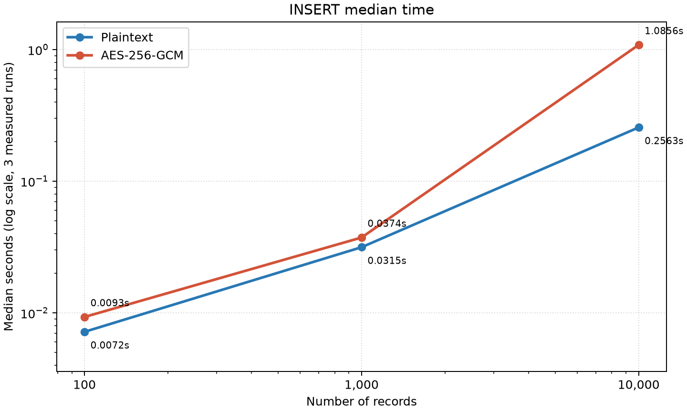
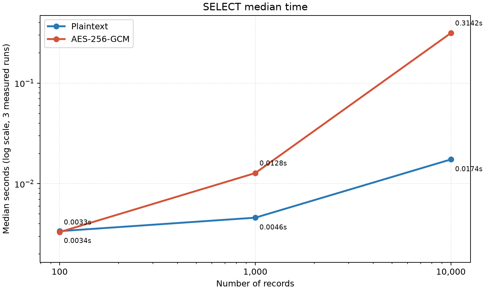

# Chương 5. Thử nghiệm bảo mật và hiệu năng — bản ghép để TV3 rà soát

Ngày cập nhật: 16/11/2026. Tất cả hồ sơ và khóa dùng trong thử nghiệm là dữ liệu giả. Nội dung này tổng hợp phép thử đã chạy; TV3 cần xác nhận phần trình bày trước khi ghép báo cáo cuối.

## 5.1. Môi trường và phương pháp

- Máy đo benchmark ngày 15/11: Intel Core i7-12700H, RAM 15,7 GiB, Windows 11 Home 10.0.26300; Docker Engine 29.6.2; PostgreSQL 17.12 trong container; Python host 3.12.1, API image Python 3.12.16. Có tải nền thông thường, không phải máy đo chuyên dụng.
- Ngày 16/11, kiểm tra lại code tích hợp bằng Python 3.12.1: **102 passed**. Riêng bốn file test TV1: **48 passed**, coverage dòng và nhánh **100%** trên 93 câu lệnh, 18 nhánh. Kết quả coverage được đo bằng `pytest-cov` cài riêng trong venv, không phải số đo CI.
- API/PostgreSQL ngày 16/11 chạy trong Docker Compose project cô lập với `.env`, cổng và volume mới. `scripts.demo_client` tạo hai hồ sơ giả; `scripts.verify_tv2` đạt **19/19**; `scripts.attack_lab` đạt A1–A5 với xác nhận restore. [Log chạy mới](evidence/merge_validation_2026-11-16.json), [smoke JSON](tv2_verification.json), [đầu ra SQL ciphertext](evidence/psql_ciphertext_2026-11-16.txt).
- Benchmark ngày 15/11 chạy trên PostgreSQL thật, tách bảng `bench_plain` và `bench_encrypted`; mỗi mức `n` chạy một lần warmup bỏ khỏi thống kê rồi ba lần lấy trung vị. Thời gian INSERT gồm tạo payload và mã hóa ở chế độ AES-GCM, sau đó ghi DB; SELECT gồm đọc toàn bộ hàng và giải mã ở chế độ AES-GCM. Thời gian xóa bảng trước lần ghi không được tính.

## 5.2. Bộ test và kết quả

| Lớp kiểm tra | Điều kiện đại diện | Kết quả |
|---|---|---|
| TV1 unit | H1, C01–C07, khóa, auth, init_env, cả lỗi UTF-8 của issue #6 | 48 passed; coverage 100% dòng/nhánh |
| TV2 API/DB | CRUD, schema, H2/H3, lỗi 401/403/404/409/422, giao dịch | Nằm trong 102 passed; smoke PostgreSQL 19/19 |
| TV3 security | A1–A5, A8, phân quyền mọi route, dữ liệu bị sửa | Nằm trong 102 passed |
| Công cụ attack | Từ chối pass giả khi A2 mất dữ liệu hoặc A4/A5 trả 409 sai `code`; restore khi HTTP lỗi | 9 test công cụ đạt, thuộc tổng 102 |

## 5.3. Nhật ký A1–A8

| Mã | Expected | Actual đã kiểm | Kết luận |
|---|---|---|---|
| A1 | Không token → 401 | API thật: 401 | Đạt |
| A2 | Viewer DELETE → 403, DB và payload nguyên | API thật: 403; byte hàng và payload sau đọc lại bằng trước | Đạt |
| A3 | SQL thô không chứa plaintext ở 3 cột nhạy cảm | Hai hồ sơ demo, cả ba trường: ciphertext dài thêm tag 16 byte, nonce 12 byte, không chứa plaintext; `psql` xác nhận hex | Đạt phạm vi quan sát SQL |
| A4 | Sửa byte CT → 409 `integrity_failure`, khôi phục | API thật trả 409 đúng code; byte hàng và payload khôi phục đúng | Đạt |
| A5 | Tráo CT + nonce giữa hai hàng → 409 `integrity_failure`, khôi phục | API thật trả 409 đúng code; cả hai hàng và payload khôi phục | Đạt |
| A6 | Sai khóa → `IntegrityFailure` | `test_c03_wrong_key` đạt | Đạt mức module |
| A7 | Replay cùng ô vẫn giải mã được | `test_c07_replay_same_row_is_still_accepted` đạt | Giới hạn thiết kế đã xác nhận |
| A8 | ID kiểu SQL → 422, DB không đổi | Hai ca security test đạt; thử PostgreSQL ngày 15/11 cũng trả 422, hàng không đổi | Đạt phạm vi ID theo H2 |

A1–A5 được chạy bằng `scripts.attack_lab` ngày 16/11; A6/A7 từ bộ test TV1; A8 từ test bảo mật và [audit PostgreSQL ngày 15/11](evidence/attack_postgresql_audit.json). Công cụ không dùng mọi 409 làm bằng chứng: phải có `code=integrity_failure`, không chứa giá trị nhạy cảm; A2 và restore phải so cả DB lẫn payload API. Kết quả A3 không chứng minh khả năng chống phá AES; nó chỉ quan sát đúng ranh giới bản dump DB không có khóa.

## 5.4. Benchmark và overhead

| Số hồ sơ | Plain INSERT (s) | AES INSERT (s) | Tăng INSERT | Plain SELECT (s) | AES SELECT (s) | Tăng SELECT | Payload plain / AES (byte) |
|---:|---:|---:|---:|---:|---:|---:|---:|
| 100 | 0,007180 | 0,009313 | +29,7% | 0,003379 | 0,003308 | −2,1% | 4.000 / 12.400 |
| 1.000 | 0,031539 | 0,037374 | +18,5% | 0,004598 | 0,012758 | +177,5% | 40.000 / 124.000 |
| 10.000 | 0,256266 | 1,085616 | +323,6% | 0,017435 | 0,314231 | +1.702,3% | 400.000 / 1.240.000 |

Hai biểu đồ dùng trục log để thấy cả ba mức `n`; tạo lại bằng `python -m scripts.plot_benchmark --csv benchmark_results.csv` sau khi chạy benchmark và cài `matplotlib`. `benchmark_results.csv` được gitignore theo kế hoạch; bảng trên chứa số liệu đã đo. Payload AES tăng cố định **84 byte/hồ sơ** (ba tag 16 byte và ba nonce 12 byte), tương đương **+210%** so với 40 byte plaintext mẫu. `payload_bytes` chỉ cộng ba trường và nonce/tag, không đo dung lượng bảng, index hoặc WAL trên đĩa.

Mẫu SELECT ở `n=100` cho −2,1% do nhiễu ở mức mili giây; không suy ra mã hóa làm đọc nhanh hơn. Chi phí lớn ở `n=10.000` gồm mã hóa/giải mã ba trường cho mỗi hồ sơ trong Python; kết quả còn phụ thuộc CPU, DB, tải nền, mạng loopback và kích thước payload. Đây là phép đo minh họa, không phải cam kết hiệu năng production.

## 5.5. Giới hạn và bằng chứng trình bày

AES-GCM bảo vệ ba trường khi chỉ lộ bản dump DB nhưng không lộ khóa; AAD phát hiện tráo giữa hàng/cột. `student_id`, họ tên, ngành, số hàng và độ dài ciphertext vẫn lộ. Khóa hoặc máy ứng dụng bị chiếm thì dữ liệu có thể bị giải mã; A7 cho thấy replay cùng ô vẫn hợp lệ. Token tĩnh, HTTP loopback, không có KMS/key rotation và chưa có cơ chế tìm kiếm trực tiếp trên ciphertext.

Log JSON, đầu ra `psql` và biểu đồ là minh chứng máy được lưu trong repo. Ảnh Swagger, terminal attack lab và GitHub Actions cần chụp ở buổi nghiệm thu trên commit PR/main cuối cùng, che token và khóa; không dùng ảnh cũ để nhận là ảnh của bản release.
