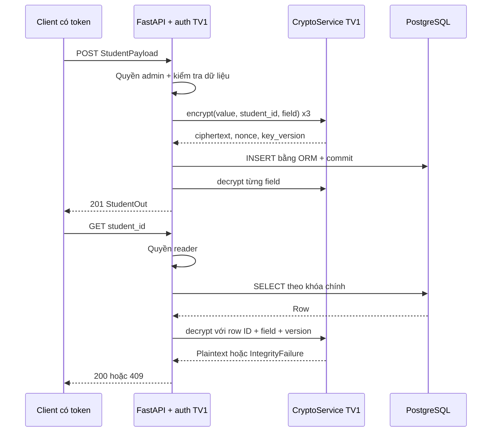

# TV2 — API, PostgreSQL và Docker

## Trạng thái và phạm vi

**Cập nhật 15/11/2026:** nhánh `integration/tv2-merge-prep` ghép API/DB của TV2 với AES-256-GCM đã merge trên `origin/main` và nhánh `feature/security-benchmark` của TV3. Xem [kết quả rà soát và thứ tự merge](TV2_MERGE_READINESS.md). Đây là bản chuẩn bị local, chưa merge lên GitHub.

Đối chiếu theo kế hoạch TV2 đang lưu trong `docs/ke-hoach/Ke_hoach_thuc_hien_TV2.md` và [issue H1–H5 #3](https://github.com/world-ender1/database-encryption-lab/issues/3). Giữ nguyên H1–H5; việc xác nhận hợp đồng của cả nhóm còn được theo dõi tại issue. Không cần hạ CRUD về khung 501 để dựng lại các mốc lịch sử.

Module `app/crypto_service.py` dùng AES-256-GCM thật của TV1, khóa 32 byte, nonce 12 byte, tag 16 byte và AAD gắn ID/field/phiên bản khóa. Chỉ dùng dữ liệu giả; xem hex không thay cho kiểm thử mật mã.

## Chạy trên Windows PowerShell

Chạy từ thư mục gốc repo. Python 3.12 và Docker Desktop phải có sẵn.

```powershell
py -3.12 -m venv .venv
.\.venv\Scripts\python.exe -m pip install -r requirements.txt
.\.venv\Scripts\python.exe scripts/init_env.py
docker compose up -d --build --wait --wait-timeout 120
docker compose ps
Invoke-RestMethod http://127.0.0.1:8000/health
.\.venv\Scripts\python.exe -m scripts.demo_client
.\.venv\Scripts\python.exe -m pytest -q
.\.venv\Scripts\python.exe -m scripts.verify_tv2
```

Trên macOS/Linux dùng `python3 -m venv .venv`, rồi `.venv/bin/python` thay đường dẫn Windows. Trình tạo `.env` giữ nguyên file nếu đã tồn tại. Không cần activate venv và không cần đổi execution policy.

Swagger: <http://127.0.0.1:8000/docs>. Nhấn **Authorize**, nhập riêng giá trị `ADMIN_TOKEN` hoặc `VIEWER_TOKEN` lấy từ `.env` của máy mình; HTTPBearer sẽ thêm `Bearer`. Chuẩn bị trước khi chia sẻ màn hình, không đưa token vào báo cáo. Nếu thay `API_PORT`, dùng cổng mới cho cả `/health` và `/docs`.

`demo_client` tạo SV9001/SV9002, bỏ qua bản ghi trùng và kiểm tra GET từng bản ghi. Mã thoát khác 0 nếu tạo/đọc thất bại. `--reset` xóa **chỉ SV9001 và SV9002** trước khi tạo lại; dùng sau khi TV1 thay bản crypto tạm. Chỉ chạy reset khi hai mã này là dữ liệu demo được phép thay thế.

`verify_tv2` tạo một mã ngẫu nhiên riêng, kiểm tra trực tiếp PostgreSQL và API rồi xóa hồ sơ do nó tạo; không thay dữ liệu H5. Kết quả ghi `docs/tv2_verification.json`, không ghi key/token/URL kết nối. Exit 0 = kiểm tra đạt, 1 = lỗi vận hành/API hoặc nhiều điều kiện sai, 2 = chỉ điều kiện không chứa plaintext thất bại. Script kiểm cả độ dài tag, nonce và phiên bản khóa nhưng không thay thế attack lab của TV3 hoặc đánh giá an toàn mật mã.

## Cấu hình H4

| Biến | Giá trị / mục đích | Nơi dùng |
|---|---|---|
| `DATABASE_URL` | `postgresql+psycopg://demo:<password>@127.0.0.1:<DB_PORT>/encryption_demo` | Python trên máy host |
| `POSTGRES_PASSWORD` | Mật khẩu ngẫu nhiên từ init_env | Compose DB và URL nội bộ API |
| `ENCRYPTION_KEY_B64` | Base64 của khóa 32 byte | `get_crypto()` gọi `decode_key` của TV1 |
| `KEY_VERSION` | Mặc định `v1` | Crypto và cột metadata |
| `ADMIN_TOKEN` | Token có quyền đọc/ghi | `auth.py` của TV1 |
| `VIEWER_TOKEN` | Token chỉ đọc | `auth.py` của TV1 |
| `API_PORT` | Mặc định `8000` | Cổng API host, demo_client, verify_tv2 |
| `DB_PORT` | Mặc định `55432` | Cổng DB host |

`Settings` công khai 5 field chữ thường: `database_url`, `encryption_key_b64`, `key_version`, `admin_token`, `viewer_token`. Ba biến còn lại phục vụ Compose/script, không phải field Settings. Biến môi trường tiến trình ưu tiên hơn `.env`; `extra="ignore"` cho phép `.env` có đủ H4.

Trong container, `127.0.0.1` là chính container đó. Compose ghi đè `DATABASE_URL` của API thành `...@db:5432/encryption_demo`; `db` là tên service trong mạng Compose. Cả API và DB chỉ công bố cổng host tại `127.0.0.1`.

`get_settings()` và `get_crypto()` có cache. Sau khi đổi cấu hình cần tạo lại container API: `docker compose up -d --force-recreate api`. Không tự đổi khóa khi DB vẫn chứa ciphertext cần giữ. `KEY_VERSION` chỉ là metadata, chưa phải cơ chế xoay khóa.

## Schema H3

| Cột | PostgreSQL | Ý nghĩa |
|---|---|---|
| `student_id` | VARCHAR(16), PRIMARY KEY | ID rõ, chỉ chữ/số ASCII |
| `full_name` | VARCHAR(150), NOT NULL | Tên rõ |
| `major` | VARCHAR(100), NOT NULL | Ngành rõ |
| `national_id_ct` | BYTEA, NOT NULL | Ciphertext CCCD giả + tag theo H1 |
| `national_id_nonce` | BYTEA, NOT NULL | Nonce riêng cho CCCD |
| `phone_ct` | BYTEA, NOT NULL | Ciphertext điện thoại + tag |
| `phone_nonce` | BYTEA, NOT NULL | Nonce riêng cho điện thoại |
| `address_ct` | BYTEA, NOT NULL | Ciphertext địa chỉ + tag |
| `address_nonce` | BYTEA, NOT NULL | Nonce riêng cho địa chỉ |
| `key_version` | VARCHAR(20), NOT NULL | Phiên bản khóa |

`LargeBinary` ánh xạ sang BYTEA trên PostgreSQL. BYTEA lưu byte; hex chỉ là cách biểu diễn khi xem, không phải thuật toán mã hóa ([PostgreSQL 17 — Binary Data Types](https://www.postgresql.org/docs/17/datatype-binary.html)). Không có cột plaintext `phone`, `national_id`, `address`. Với H1 hoàn chỉnh, nonce có 12 byte, tag 16 byte nằm cuối ciphertext.

`python -m app.init_db` tạo bảng còn thiếu bằng `create_all`, không xóa dữ liệu và không cập nhật cấu trúc bảng cũ. Thay schema cần cơ chế migration riêng. Không đổi tên H3 vì attack_lab của TV3 đọc trực tiếp các cột này.

## API H2

| HTTP | Endpoint | Quyền | Thành công | Lỗi đặc thù |
|---|---|---|---|---|
| GET | `/health` | Công khai | 200 `{"status":"ok"}` | Chỉ liveness, không truy vấn DB |
| POST | `/students` | admin | 201 + StudentOut | 409 duplicate_student |
| GET | `/students` | admin/viewer | 200 + mảng StudentOut theo ID | 409 integrity_failure cho cả danh sách |
| GET | `/students/{student_id}` | admin/viewer | 200 + StudentOut | 404 not_found; 409 integrity_failure |
| PUT | `/students/{student_id}` | admin | 200 + StudentOut | 404 not_found; 422 body không hợp lệ |
| DELETE | `/students/{student_id}` | admin | 204, body rỗng | 404 not_found |

Mọi route sinh viên: thiếu/sai token → 401 kèm `WWW-Authenticate: Bearer`; viewer ghi → 403. ID ở body POST và path theo `^[A-Za-z0-9]{1,16}$`; sai mẫu → 422. Payload cấm field thừa, không cho chuỗi rỗng. `full_name` tối đa 150, `major` 100, `national_id`/`phone` 32, `address` 255 ký tự.

Ví dụ POST với dữ liệu giả:

```json
{
  "student_id": "SV9001",
  "full_name": "Nguyen Van A",
  "major": "Computer Science",
  "national_id": "012345678901",
  "phone": "0901234567",
  "address": "Ha Noi (fictional)"
}
```

PUT cần đủ 5 field còn lại và **không có student_id**. Đây là cập nhật toàn bộ, không phải PATCH. Mỗi PUT mã hóa lại cả 3 field nhạy cảm. DELETE không cần giải mã nên xóa được hồ sơ hỏng.

```json
{"detail":"Student already exists","code":"duplicate_student"}
```

```json
{"detail":"Encrypted data failed authentication","code":"integrity_failure","student_ids":["SV9001"]}
```

GET danh sách gom toàn bộ ID giải mã lỗi, trả 409 và không trả dữ liệu của các hồ sơ khác. `IntegrityFailure` của TV1 khác với `IntegrityError` của SQLAlchemy. Trùng ID được kiểm tra sớm và kiểm tra lại sau rollback nếu hai POST tranh chấp; lỗi DB khác không bị gán nhầm thành duplicate.

## Luồng xử lý



Mỗi request lấy một Session từ `get_db`, đóng khi hoàn tất. ORM truyền tham số, không nối dữ liệu người dùng vào câu SQL. `pool_pre_ping` kiểm tra kết nối khi lấy từ pool. Rollback sau lỗi flush/commit cho phép tiếp tục dùng Session ([SQLAlchemy — Session Basics](https://docs.sqlalchemy.org/en/20/orm/session_basics.html)).

## Kiểm thử và quan sát DB

```powershell
.\.venv\Scripts\python.exe -m pytest tests/test_api.py -q
docker compose exec -T db psql -U demo -d encryption_demo -c "SELECT student_id, full_name, major, encode(phone_ct, 'hex') AS phone_ct, octet_length(phone_nonce) AS nonce_bytes, key_version FROM students ORDER BY student_id;"
.\.venv\Scripts\python.exe -m scripts.verify_tv2
```

Fixture SQLite của TV3 chỉ kiểm tra API/ORM nhanh; không chứng minh hành vi PostgreSQL. Fixture ép cấu hình test trước khi import app, dùng StaticPool và override đúng `app.database.get_db`; không đọc/ghi DB thật. Test API kiểm CRUD, validation, lỗi giao dịch, mapping đầu ra H1 vào H3 và hợp đồng 409 khi danh sách có nhiều hồ sơ hỏng. Kiểm tra quyền từng route và nonce mới nằm trong `tests/test_security.py` do TV3 phụ trách.

Compose chờ DB healthcheck đạt trước khi tạo API qua `service_healthy`, rồi healthcheck API gọi `/health` ([Docker — Startup order](https://docs.docker.com/compose/how-tos/startup-order/)). API khỏe không có nghĩa crypto thật đã sẵn sàng.

## Xử lý lỗi và giới hạn

- Trùng cổng: đổi `API_PORT`/`DB_PORT` trong `.env`; nếu đổi DB_PORT, sửa cả DATABASE_URL trên host. Tạo lại container bằng `docker compose up -d`.
- Sai mật khẩu DB: kiểm tra có tạo lại `.env` sau khi volume đã khởi tạo không. Giữ/khôi phục cấu hình cũ; không tự xóa volume.
- Chuyển crypto tạm sang thật: build lại, reset riêng hai hồ sơ demo rồi chạy smoke check. Các hồ sơ khác từ bản tạm cũng cần xử lý riêng.
- Dừng: `docker compose down` giữ volume. Không cần `down -v` để kiểm thử thường lệ.
- Git báo dubious ownership: có thể dùng `git -c safe.directory="<đường dẫn repo>" ...` cho từng lệnh; không cần thay cấu hình toàn máy.
- Chưa hỗ trợ tìm kiếm bằng `WHERE phone = ...` trên ciphertext ngẫu nhiên, phân trang, migrations, KMS, keyring hay chống replay.
- Token tĩnh, HTTP loopback và cấu hình hiện tại dành cho demo local. Không ghi body, token hoặc khóa vào log ứng dụng.

## Bàn giao

Đã chọn nguyên bản `requirements.txt` và `tests/conftest.py` từ nhánh TV3 để giải quyết xung đột; TV3 tiếp tục sở hữu hai file. Không sửa module TV1 ngoài việc lấy các commit đã merge vào main. Xem [danh sách việc còn lại](TV2_CONG_VIEC_CON_LAI.md), [Chương 3–4](TV2_BAO_CAO_CHUONG_3_4.md) và [kịch bản 3 phút](TV2_SLIDE_VA_DEMO.md).
